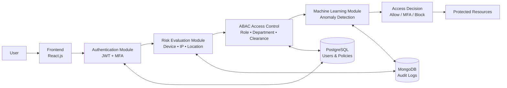

# AI-Driven Adaptive Access Control System with Behavior Intelligence

An intelligent cybersecurity framework that combines Adaptive Access Control, Behavioral Intelligence, Machine Learning, Multi-Factor Authentication (MFA), and Attribute-Based Access Control (ABAC) to enhance security beyond traditional authentication systems.

## Overview

Traditional access control systems rely heavily on static credentials such as usernames and passwords. Once authenticated, users are often granted unrestricted access without continuous verification, creating vulnerabilities to credential theft, insider threats, and unauthorized access.

This project introduces an AI-driven adaptive security system that continuously evaluates user behavior, contextual information, and access patterns to dynamically determine access privileges and security requirements.

The system integrates:

- Risk-Based Authentication
- Multi-Factor Authentication (MFA)
- Attribute-Based Access Control (ABAC)
- Behavioral Analysis
- Machine Learning-based Anomaly Detection
- Real-time Risk Assessment
- Secure Audit Logging

---

## Key Features

### Intelligent Login Risk Assessment
Evaluates login attempts using:

- Device information
- Login time
- IP address
- Geolocation
- Previous login history
- Behavioral patterns

Based on the risk score, the system can:

- Allow Access
- Request MFA Verification
- Block Access

### Multi-Factor Authentication (MFA)

Additional verification using Time-Based One-Time Passwords (TOTP) for medium-risk login attempts.

### Attribute-Based Access Control (ABAC)

Access decisions are based on:

- User Role
- Department
- Clearance Level
- Device Type
- Network Trust Level
- Time & Day Constraints

### Machine Learning-Based Threat Detection

Integrated ML models:

- Logistic Regression
- Decision Tree
- Isolation Forest

Used for:

- Risk prediction
- Anomaly detection
- Suspicious activity identification

### Continuous Monitoring

The system continuously monitors:

- User activities
- Resource access requests
- Policy violations
- Security events

### Audit Logging

All login attempts and resource access events are securely logged for:

- Compliance
- Security auditing
- Incident investigation

---

## System Architecture

## System Architecture

---

## Technology Stack

### Frontend

- React.js
- JavaScript
- HTML5
- CSS3

### Backend

- FastAPI
- Python

### Databases

- PostgreSQL (Structured Data)
- MongoDB (Audit Logs & Activity Records)

### Machine Learning

- Scikit-learn
- NumPy
- Pandas

### Security

- JWT Authentication
- Password Hashing (bcrypt/Argon2)
- TOTP-Based MFA

### Deployment & DevOps

- Docker
- Git
- GitHub

---

## Project Modules

### 1. User Authentication Module

- Secure login
- Password hashing
- JWT generation
- MFA integration

### 2. Login Risk Evaluation Module

- Context-aware risk analysis
- IP and device validation
- Geolocation checks
- Behavioral analysis

### 3. Access Control Module

- ABAC policy enforcement
- Dynamic authorization

### 4. Machine Learning Module

- Anomaly detection
- Risk scoring
- Threat prediction

### 5. Logging & Monitoring Module

- Security event logging
- User activity tracking
- Audit trail generation

---

## Workflow

### Login Process

1. User submits credentials
2. Credentials are verified
3. Risk score is calculated
4. Risk level determined:
   - Low Risk → Access Granted
   - Medium Risk → MFA Required
   - High Risk → Access Blocked

### Resource Access Process

1. User requests resource
2. ABAC policies are evaluated
3. ML risk engine analyzes behavior
4. Final access decision is generated
5. Activity is logged

---

## Security Features

- Multi-Factor Authentication (MFA)
- Risk-Based Authentication
- JWT Session Management
- Password Hashing
- Behavioral Profiling
- Anomaly Detection
- Violation Tracking
- Automatic Account Lockout
- Secure Audit Logging

---

## Results

### Threat Detection Performance

| Threat Type | Detection Rate |
|------------|---------------|
| Role/Department Mismatch | 100% |
| Unauthorized Login Attempts | 98% |
| Suspicious Access Patterns | 96% |

### Achievements

✔ Secure MFA Implementation

✔ Dynamic Access Control

✔ AI-Powered Threat Detection

✔ Real-Time Risk Assessment

✔ Audit & Monitoring Support

✔ Scalable Architecture

---

## Future Enhancements

- Biometric Authentication
- Real-Time Continuous Learning
- Cloud Deployment (AWS/Azure)
- Microservices Architecture
- Threat Intelligence Integration
- Explainable AI Security Decisions
- Federated Learning
- Blockchain-Based Access Management

---

## Applications

- Enterprise Security Systems
- Banking & Financial Services
- Healthcare Information Systems
- Government & Defense Networks
- Cloud-Based Applications
- Educational Institutions

---

## Team

- Ishal Jahamgeer C – Machine Learning & Risk Engine
- Diya Fathima H – Frontend Development
- Muhammed Gazzali N – Backend Development & Authentication
- Muhammed A Nihal – Research & System Design

---

## License

This project is developed for academic and research purposes.

Feel free to use, modify, and extend the project with proper attribution.

---

## Acknowledgements

Special thanks to:

- TKM Institute of Technology
- Department of Computer Science and Engineering
- Project Guides and Faculty Mentors

---

## Keywords

Cybersecurity • Access Control • Artificial Intelligence • Machine Learning • ABAC • RBAC • Risk-Based Authentication • MFA • Behavioral Analytics • FastAPI • React • PostgreSQL • MongoDB
