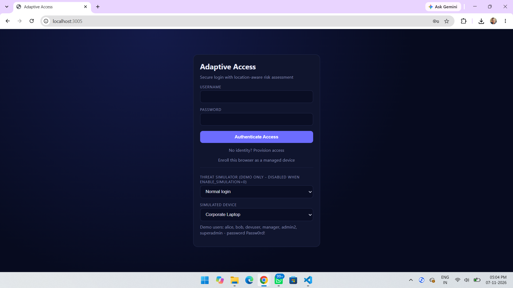
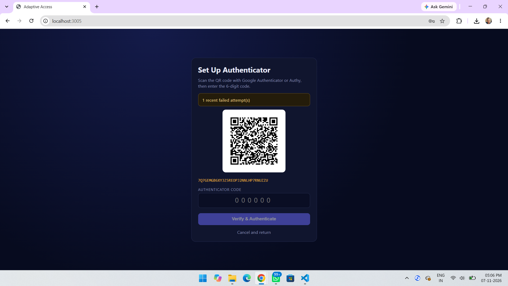
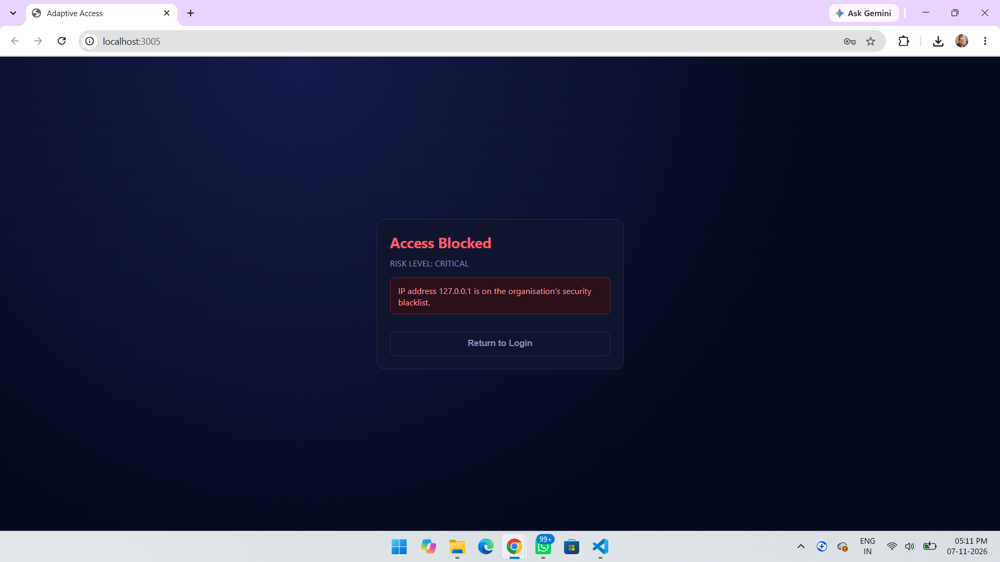
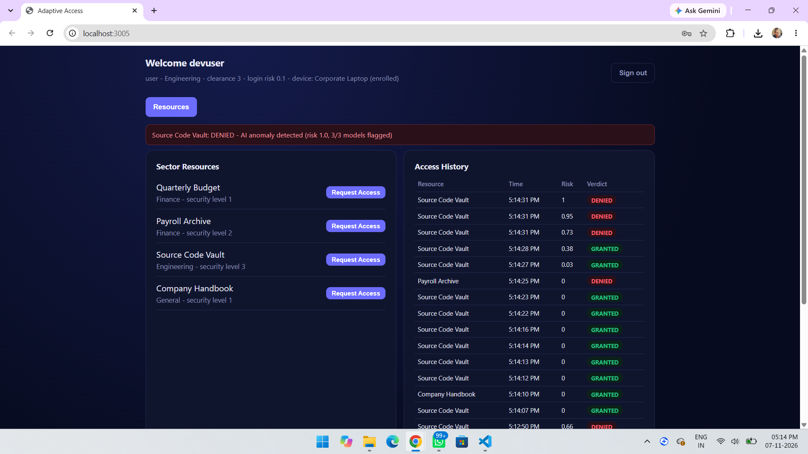
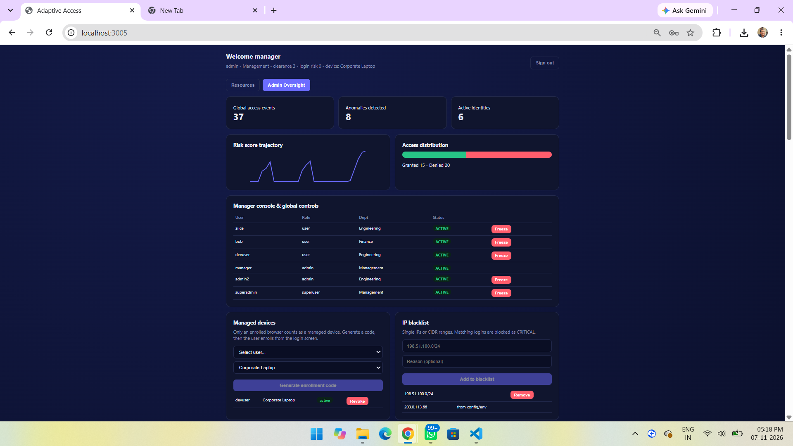
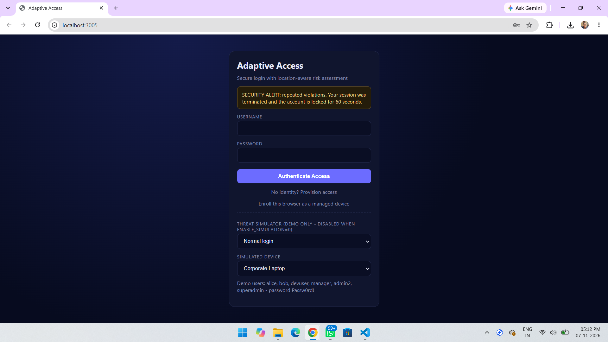
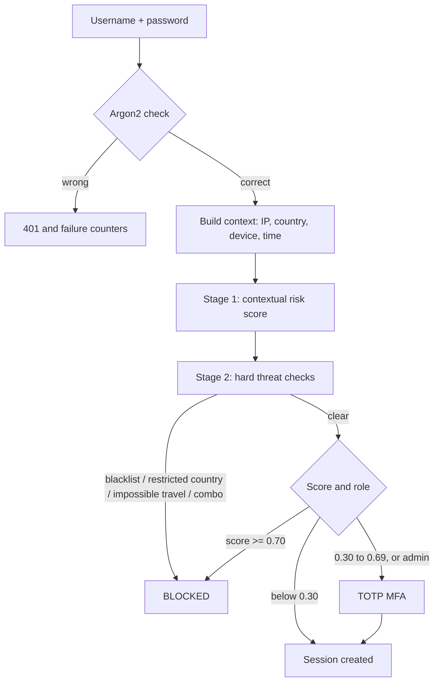
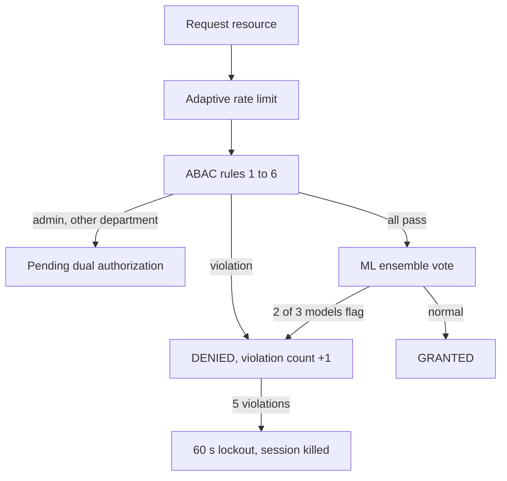

# AI-Driven Adaptive Access Control System with Behavior Intelligence

A full-stack web application that decides **how much to trust each login and each resource request**, instead of relying on a password alone. Every login is scored for risk (device, IP, location, time, history) and ends in one of three outcomes: **allow**, **ask for a TOTP code**, or **block**. After login, every resource request passes attribute-based (ABAC) policy rules and a machine-learning anomaly check.

Built as a B.Tech Project Phase II work at TKM Institute of Technology, Kollam (APJ Abdul Kalam Technological University).



## Features

- **Two-stage login risk engine**
  - Stage 1 scores context: new device, new IP, outside working hours, outside permitted days, recent failures.
  - Stage 2 blocks hard threats: blacklisted IPs, restricted countries, impossible travel, and "new device + new IP + unusual hour".
- **Adaptive MFA**: TOTP (Google Authenticator / Authy) with QR setup. Triggered by medium risk; always required for admin accounts.
- **Six ABAC policy rules** on every resource request: working hours, department match, trusted network, managed device, day of week, clearance level.
- **ML anomaly detection**: Logistic Regression + Decision Tree + Isolation Forest, majority vote.
- **Adaptive protection**: rate limit that tightens as risk rises, 15-minute lockout after repeated failed logins, 60-second lockout and forced logout after 5 policy violations, and credential-stuffing detection per IP.
- **Managed-device enrollment**: an admin issues a one-time code; the user enrolls a browser with password + code and receives a signed device token. Devices can be revoked.
- **Admin dashboard**: statistics, risk trajectory, account freeze/unfreeze, dual-authorization queue for cross-department admin access, live IP/CIDR blacklist, audit log.
- **Audit logging** to MongoDB (JSONL file fallback) with IP masking and no secrets stored.
- **Secure basics**: Argon2 password hashing, short-lived JWT sessions that can be revoked server-side.

## Screenshots

| | |
|---|---|
| <br>TOTP setup with QR code | <br>High-risk login blocked |
| <br>Resource access with verdicts | <br>Admin oversight |
| <br>Lockout after repeated violations | |

## How it works

### Login



### Resource access



### The ML engine

Ten features per request: hour, weekday, resource sensitivity, clearance gap, trusted network, managed device, new device, new IP, recent violations, request burst. Three models vote; two or more flags deny access.

> The models are trained on **synthetic** behavior data generated at first start (no real user logs were available). Training accuracy figures printed at startup describe that synthetic data only, not real-world performance.

## Tech stack

| Layer | Technology |
|---|---|
| Frontend | React 18, Vite |
| Backend | Python, FastAPI, SQLAlchemy |
| Databases | PostgreSQL (or SQLite by default) for users and policy data, MongoDB (or JSONL file) for audit logs |
| Security | Argon2, JWT, TOTP (pyotp) |
| ML | scikit-learn, NumPy, joblib |
| Optional | Docker Compose (PostgreSQL + MongoDB), GeoLite2 for local GeoIP |

## Project structure

```
backend/
  app/
    main.py        API routes
    config.py      thresholds, resources, settings
    risk.py        login risk scoring, blacklist, failed-login tracking
    abac.py        the six ABAC rules
    ml.py          feature building, training, prediction
    context.py     real client IP, country, device, time
    devices.py     managed-device enrollment and trust
    geo.py         GeoIP lookup
    security.py    Argon2, JWT, TOTP
    audit.py       audit logging
  test_flow.py     end-to-end smoke test
frontend/src/      React app (login, MFA, dashboard, admin)
docker-compose.yml optional PostgreSQL + MongoDB
```

## Getting started

**Requirements:** Python 3.10+, Node.js 18+, Git. Docker is optional.

### 1. Backend

```bash
cd backend
python -m venv .venv
# Windows: .venv\Scripts\activate      macOS/Linux: source .venv/bin/activate
pip install -r requirements.txt
python test_flow.py        # optional smoke test, should end with ALL TESTS PASSED
uvicorn app.main:app --reload --port 8000
```

The first start trains the ML models and creates demo users. API docs: http://127.0.0.1:8000/docs

### 2. Frontend (second terminal)

```bash
cd frontend
npm install
npm run dev
```

Open http://localhost:3005

### 3. Optional: PostgreSQL and MongoDB

```bash
docker compose up -d
cp backend/.env.example backend/.env    # then enable the PostgreSQL DATABASE_URL line
```

Without Docker the app uses SQLite and writes the audit log to `audit_log.jsonl`.

## Demo users

All use the password `Passw0rd!`.

| User | Role | Department | Notes |
|---|---|---|---|
| `devuser` | user | Engineering | clearance 3, any hour or day (easiest for demos) |
| `alice` | user | Engineering | clearance 2, Mon-Fri 9-17 |
| `bob` | user | Finance | clearance 3, Mon-Fri 9-17 |
| `manager`, `admin2` | admin | Management / Engineering | MFA always required, can freeze users and approve requests |
| `superadmin` | superuser | Management | same as admin |

## Try these scenarios

1. **Normal access:** log in as `devuser`, request *Source Code Vault* (granted) and *Quarterly Budget* (denied, wrong department).
2. **MFA:** log in as `manager`, scan the QR code, enter the code, open *Admin Oversight*.
3. **Threat simulator:** on the login page pick *Blacklisted IP*, *Restricted country*, or *Impossible travel* and log in.
4. **Lockout:** as `devuser`, request *Quarterly Budget* five times in a row.
5. **Managed device:** as `manager`, generate an enrollment code for `devuser`, then use *Enroll this browser as a managed device* on the login page.

## Demo mode vs real signals

By default `ENABLE_SIMULATION=1`, so the login page can inject a fake IP, country, and device to demonstrate threats from a single machine. **This is for demos only.** To use real signals, set in `backend/.env`:

```
ENABLE_SIMULATION=0
SECRET_KEY=<a long random string>
TRUSTED_PROXIES=<your reverse proxy IPs, if any>
```

| Signal | Real mode |
|---|---|
| Client IP | Actual socket address; `X-Forwarded-For` only trusted from listed proxies |
| Country | Local GeoLite2 database (`backend/geoip/GeoLite2-Country.mmdb`) or a cached HTTPS lookup |
| Managed device | Only browsers enrolled through the admin-issued code count; header claims are ignored |
| Blacklist | Editable live in the admin dashboard (IPs or CIDR ranges) |

## API overview

| Endpoint | Purpose |
|---|---|
| `POST /api/auth/register`, `/login` | Create account, risk-evaluated login |
| `POST /api/auth/mfa/setup`, `/mfa/verify` | TOTP enrollment and verification |
| `POST /api/devices/enroll` | Enroll a browser as a managed device |
| `GET /api/resources`, `POST /api/resources/{id}/access` | List resources, request access |
| `GET /api/history`, `GET /api/me` | Own access history and profile |
| `/api/admin/*` | Stats, users, freeze, dual-authorization, devices, blacklist, audit log |

## Limitations and future work

- ML models are trained on synthetic data; real deployment needs real behavior logs and continuous learning.
- Failed-login tracking is in memory; use Redis if running multiple workers.
- No live threat-intelligence feed; the blacklist is managed manually.
- No biometric factor; TOTP is the only second factor.
- Prototype scale: not load-tested.

## Team

| Member | Contribution |
|---|---|
| Ishal Jahamgeer C | Machine learning models, AI risk engine integration, testing and validation |
| Diya Fathima H | Frontend, dashboard design |
| Muhammad Gazzali N | Backend, authentication, database setup |
| Muhammed A Nihal | Literature review, requirements, system architecture |

Guided by Dr. Ajesh F and Dr. Sanila S, Department of Computer Science and Engineering, TKM Institute of Technology.
